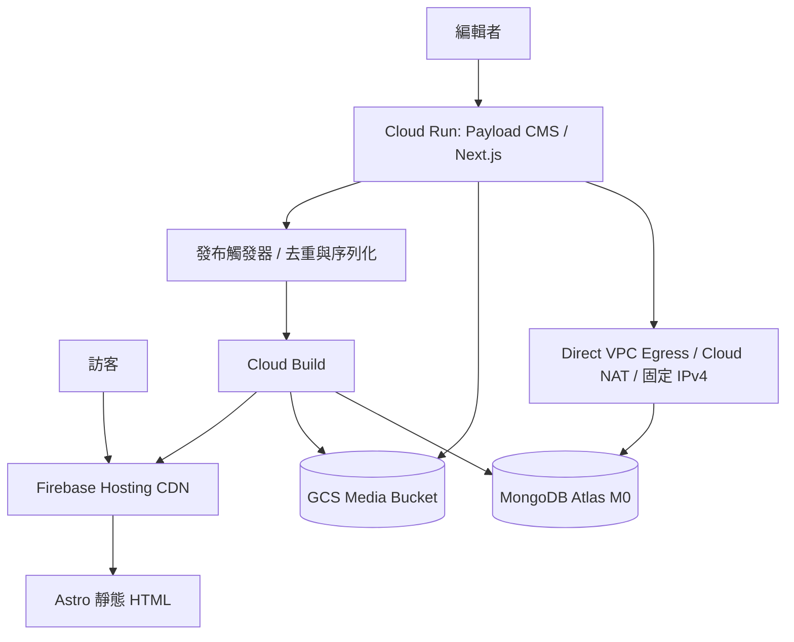

# Architecture — 架構與資料流

## 1. 系統圖

## 2. 責任分工
- Astro：僅公開展示，build-time 取得 published 內容，不含 CMS 密鑰。
- Payload：Next.js Admin、Users、Posts、Categories、Tags、Media、draft/version、ACL、REST/Local API。
- MongoDB Atlas：文章及其 Lexical JSON、分類、標籤、使用者、版本與發佈狀態。
- GCS：媒體二進位檔；Metadata 保留在 MongoDB。
- Cloud Run：只執行 CMS；min-instances=0、max-instances=1 起步。
- Cloud NAT：提供 CMS 對 Atlas 的固定出口 IPv4；`all-traffic` 讓公開 IP 流量經 NAT。
- Cloud Build：受控讀取 published 資料快照、建置 Astro、部署 Hosting。

### 本機開發對應與階段邊界

上述系統圖為雲端目標架構。依 ADR-008，Phase 0～4 全部在本機開發及驗收：Payload 連接共用 Docker MongoDB replica set；媒體使用 Payload 本機 upload 與受保護持久化目錄／volume；snapshot 儲存在本機不可變 release 路徑；發布執行器呼叫本機 Astro build 並切換本機靜態預覽版本。草稿媒體不得直接置於公開靜態目錄，公開站仍只讀 published snapshot。

DTO、媒體存取規則、release 狀態機與原子序列化契約須可獨立測試；本機與雲端的差異集中於 storage／build／deploy adapter。雲端 adapter 程式與 GCS、Terraform、Cloud Build、Hosting 設定須在本機階段完成實作及契約／靜態檢查；真實服務整合在 P04-06 本機 UAT 通過後的 Phase 5 執行。本機測試不需要 NAT、Atlas 或雲端身分。

## 3. 讀取路徑
訪客 → Hosting CDN → 靜態 HTML/Assets；沒有 Cloud Run、MongoDB request-time 依賴。

## 4. 編輯路徑
管理者登入 Payload → Payload ACL → MongoDB CRUD；媒體經 GCS storage adapter 持久化。Cloud Run 容器檔案系統不可當永久媒體儲存。

## 5. 發布路徑（重點）
1. 管理者發布/取消發布/刪除內容；Payload hook 只送出事件，不同步等待完整建置。
2. 事件先經去重、合併、序列化（MVP 可用單一受保護 trigger + 部署鎖；若需要可靠佇列，評估 Cloud Tasks/Firestore 並列入成本）。
3. Cloud Build 取得固定 Git commit、內容快照版本；**不要讓建置中途讀到不同版本**。
4. 將 published DTO 輸出為 build artifact，執行 Astro build、HTML/link/SEO smoke test。
5. 建置成功後部署 Firebase Hosting，保存部署 ID、commit、內容快照 ID；失敗不覆蓋現有版本。
6. 取消發布和刪除也必須重建，確保舊文章 URL 不再被新站列出；視政策輸出 404/410。

## 6. 內容快照方案
MVP 建議在 Cloud Build 啟動時將 published 文章與分類/標籤匯出到 `gs://...-build-snapshots/<release-id>/`，後續 Astro 只讀該 immutable snapshot。需處理並發：單一 publisher、遞增 release number、部署前驗證最新 release；較舊 build 禁止覆蓋新版本。

## 7. 資料庫 M0 限制
Atlas M0 免費但資源受限；連線數、儲存、效能與備份能力應以當下 Atlas Console/官方文件確認。Payload 的 draft/version 會增加資料量。本機先驗證索引、聚合、交易、版本操作與升級路徑並記錄待驗項目；真實 M0 複驗於 P05-04 執行，為雲端驗收與正式上線門檻，不是本機開發前置條件。

## 8. 預覽策略
v1 使用 Payload 自身已登入的預覽頁，受 session 保護並顯示草稿。公開 Astro 不支援直接 SSR 草稿預覽；若要求完全一致的 Astro 即時預覽，列為 P1 另行設計。
